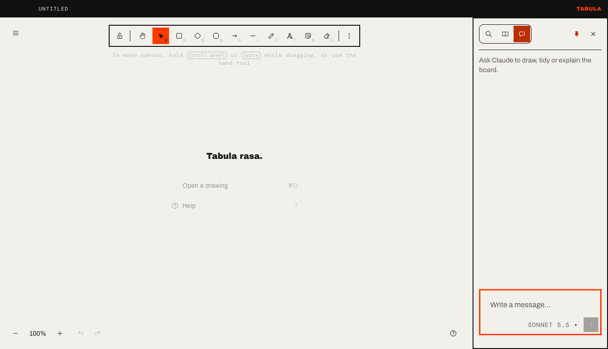
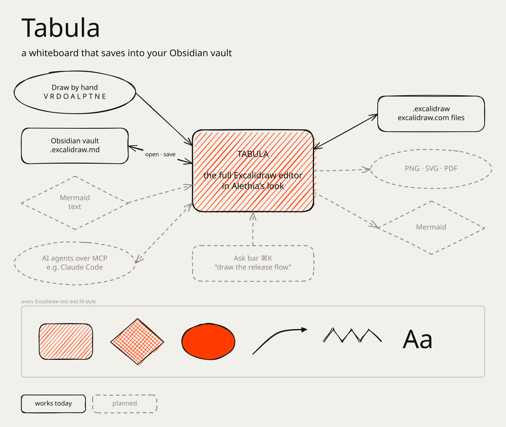

# Tabula

An AI-enabled whiteboard for macOS, built on
[Excalidraw](https://github.com/excalidraw/excalidraw) and saving straight into
your Obsidian vault. Ask Claude to sketch, tidy or explain the board in a chat
beside the canvas, or let Claude Code draw on it over MCP.



*The chat drawing on the board. For a repeatable recording, the model's reply
is scripted ([`scripts/record-demo.mjs`](scripts/record-demo.mjs)); the tool
calls, the Mermaid conversion and the drawing are Tabula running as it does
with a live model.*

Tabula wraps the full Excalidraw editor in a native Mac app. Every tool and
shortcut works as it does on excalidraw.com. Drawings save as Obsidian
Excalidraw plugin files (`.excalidraw.md`), so they sit in a vault next to
your notes and stay searchable and linkable there.

The name is the Roman wax tablet; *tabula rasa* is the blank slate a drawing
starts from. It is a sibling of [Alethia](https://github.com/billyhunt/alethia-markdown-editor),
a markdown editor, and shares its look: paper ground, hard black rules, one
hot orange.

<picture>
  <source media="(prefers-color-scheme: dark)" srcset="docs/capabilities-dark.svg">
  
</picture>

*Drawn in Tabula, and last updated by an agent driving Tabula over MCP. The
source is [`docs/capabilities.excalidraw.md`](docs/capabilities.excalidraw.md):
open it in Tabula, or in Obsidian with the Excalidraw plugin.*

> Tabula is an independent project. It is not affiliated with or endorsed by
> Excalidraw.

## Status

Early alpha. It runs from source on Apple-silicon Macs; there is no signed
release yet.

### AI

- **Chat** (the first tab of the sidebar, docked on the right and open by
  default; ⌘J focuses it, View ▸ Show Chat turns it off). Tell Claude what to
  draw or change and watch it work on the board, then follow up ("make it
  bigger", "now connect those"): it remembers the conversation until **New
  chat**.
  - With a selection it works on just that ("tidy this up", "turn these notes
    into a flowchart").
  - Each change Claude makes is one undo step, and the title bar shows what
    it is doing.
  - The model button beside the box switches between the models you picked in
    Settings (see [AI settings](#ai-settings)).
  - Select and copy any of the conversation, or use **Copy** (the whole chat as
    Markdown) and **Save…** (a `.md` file named `<drawing> chat.md`, suggested
    next to the drawing once it has a name; an untitled drawing's chat starts
    in your usual save folder).
- **Text to diagram** (Agent ▸ Text to Diagram…): describe a diagram, preview
  the Mermaid Claude writes, then insert it as editable shapes.
- **Agents over MCP**: a built-in MCP server lets Claude Code, or any MCP
  client, read and draw on the open board with the same tools the chat uses
  (see [Connecting an agent](#connecting-an-agent)).

### Drawing and files

- The full Excalidraw editor, with excalidraw.com's tools and shortcuts.
- Typing into a shape: double-click anywhere inside it, not just near the
  centre, or select it and type in the **Label** field at the top of the
  left panel. ⌥ double-click still drops loose text.
- Open and save `.excalidraw.md` (Obsidian Excalidraw plugin) and
  `.excalidraw`.
- Autosave for everything: a drawing is saved a moment after you stop editing
  and again before its window closes or the app quits.
  - One that was never saved gets its own file,
    `Documents/Tabula/Untitled <date> <time>.excalidraw.md`, with no dialog.
    ⌘S on it asks for a name and moves it there.
  - New and Open save the current drawing instead of asking. An agent's new
    and open commands leave it alone and use a window of their own (the
    current one only if it is still blank).
  - A version history (File ▸ Browse Versions…) keeps what every save
    replaced, with a preview and restore.
- Export to PNG, SVG, PDF (one page per frame, if you like) and Mermaid, or
  copy as PNG, SVG or Mermaid. Menu exports cover the whole board; File ▸
  Export Image… (⇧⌘E) opens covering the whole board too, with an "Only
  selected" switch for just the selection.
- Mermaid import: File ▸ Import Mermaid…, or paste a Mermaid diagram onto the
  canvas (⇧⌘V pastes it as text).
- **Library**: shapes you add to Excalidraw's library are kept for every
  window and across restarts. "Browse libraries" opens
  libraries.excalidraw.com, whose **Add to Excalidraw** button hands the
  library back to Tabula through a `tabula://` link; Tabula downloads it (only
  from excalidraw.com hosts) and asks before adding it.
- Light and dark mode, following macOS.
- Works offline: all fonts are bundled. New text, including text the chat,
  agents and Mermaid import add, is in Comic Shanns rather than Excalidraw's
  hand-drawn Excalifont.

## AI settings

The chat and Text to diagram call a model with your own key, from Anthropic
or [OpenRouter](https://openrouter.ai). The first message you send without a
key opens **Settings** (⌘,) at the key field. Pick the provider and paste its
API key. Tabula encrypts the key with a secret held in your macOS Keychain
(Electron `safeStorage`) and stores it in its own app data folder; the key
never leaves the app's main process. `ANTHROPIC_API_KEY` or
`OPENROUTER_API_KEY` in the environment takes precedence over a saved key.

**Models in the chat** lists the provider's models (Anthropic's need the key
first; OpenRouter's are cut to those that can use tools, which the chat
needs). The ones you tick appear in the chat's model menu. Each provider keeps
its own list and choice; the defaults are `claude-sonnet-5-5` on Anthropic
and `anthropic/claude-sonnet-5.5` on OpenRouter. OpenRouter is called through
its Anthropic-compatible Messages API.

## Running it

```bash
npm install
npm run dev
```

`npm run dev` starts Vite and launches Electron against it, with hot reload.

```bash
npm test          # unit tests
npm run test:e2e  # builds, then drives the app with Playwright
npm run package   # unsigned Apple-silicon .app in release/mac-arm64/, then opens it
npm run open      # opens the newest packaged build, quitting any older copy
npm run ship      # package, quit every copy, replace /Applications/Tabula.app, reopen it
npm run demo      # builds, then re-records docs/demo.gif
```

`npm run open` picks whichever of `release/` and `release-next/` (test
builds) was built last. Any other running copy is quit first, which saves
its unsaved drawings, so the app in the Dock is always the newest build.
`npm run ship` does the same for the copy in `/Applications`; it stops
without replacing anything if a copy won't quit (a save prompt, say).

The end-to-end run uses a throwaway profile and a fake Anthropic API, so it
needs no key. Set `TABULA_E2E_APP` to a packaged app's binary to run it
against the packaged build.

## Connecting an agent

Turn on **Agent ▸ Allow Agent Connections (MCP)** in the menu bar, then copy the
setup command from Settings and run it once:

```bash
claude mcp add --transport http tabula http://127.0.0.1:7337/mcp --header "Authorization: Bearer <token>"
```

The server listens on 127.0.0.1 only, needs that token (kept in Tabula's
app-support folder; Settings can replace it), and refuses requests from web
pages. Agents get the same tools as the chat — read the drawing, add,
change and delete elements, import Mermaid, select, zoom, screenshot — plus
export, open, save and new drawing. Every change is one undo step, and agent
saves never open a dialog.

## File format

Tabula's native format is the
[Obsidian Excalidraw plugin](https://github.com/zsviczian/obsidian-excalidraw-plugin)'s
`.excalidraw.md`: a markdown file with the drawing's text pulled out as
searchable text, and the drawing data in a fenced block.

- Tabula writes the drawing data as plain JSON, so files are readable and
  diff well in git. It reads both plain and compressed files.
- Re-saving keeps everything Tabula doesn't own: frontmatter, notes above the
  drawing, element links, embedded files, and `[[wiki links]]` in drawing
  text.
- Plain `.excalidraw` files, as used by excalidraw.com, open too, and save
  back in their own format.

To edit the same drawings in Obsidian, install the Excalidraw plugin there.

## Architecture

| Directory | Runs in | Purpose |
|---|---|---|
| `src/main/` | Electron main | Window, menus, file dialogs, file I/O, version history, PDF printing |
| `src/main/agent/` | Electron main | MCP server, model calls and chat history (chat, Text to diagram), API keys |
| `src/preload/` | Preload (sandboxed) | The only bridge between page and main |
| `src/renderer/` | Chromium | React shell around the Excalidraw editor |
| `src/renderer/agent/` | Chromium | Canvas tools agents call, the chat, Settings |
| `src/renderer/canvas/` | Chromium | Placing elements, double-click labelling, the Label field |
| `src/renderer/export/`, `mermaid/` | Chromium | Exports, Mermaid writer and import |
| `src/renderer/format/` | Chromium | `.excalidraw.md` reader and writer |
| `src/shared/` | Both | IPC channels and types, the canvas tool schemas |

The scene lives in the page, so both the MCP server and the chat reach it
the same way: main validates a tool call and forwards it to the window, which
runs it against the editor. Paths and file writes stay in main. The packaged
app serves the page from an `app://tabula/` origin rather than `file://`, so
the strict content security policy can allow the bundled fonts.

Excalidraw is used as a library, unmodified. It is pinned to an exact build
of the npm `next` channel, which is what excalidraw.com runs; the `latest`
release still uses number keys for tools. The one seam: `vite.config.ts`
aliases `@excalidraw/mermaid-to-excalidraw` to a wrapper that sets the font
on converted text, because Excalidraw's Mermaid dialogs have no hook for it.

## License

MIT. See [`LICENSE`](LICENSE).

Tabula bundles Excalidraw (MIT), several fonts (mostly SIL OFL 1.1) and about
380 open-source packages. See [`THIRD_PARTY_NOTICES.md`](THIRD_PARTY_NOTICES.md).
